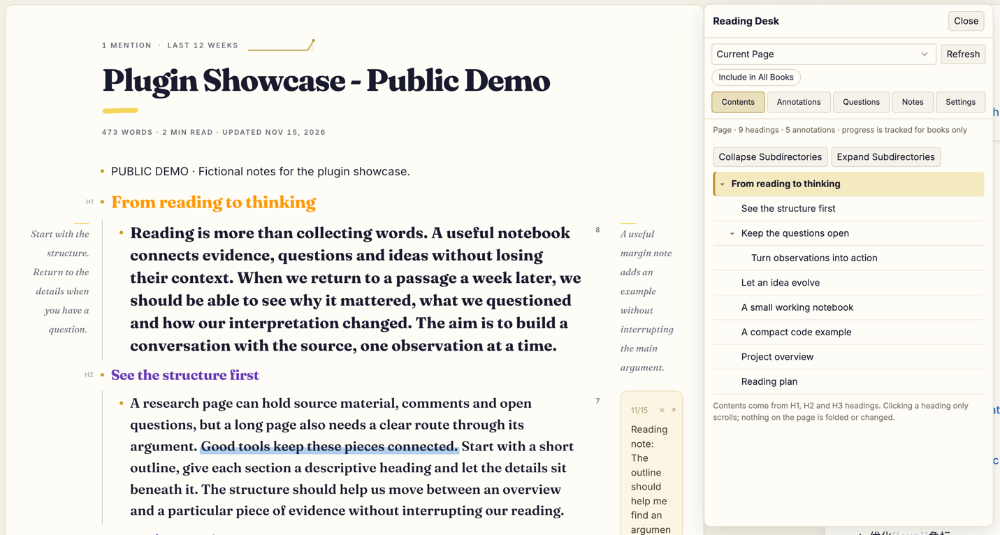
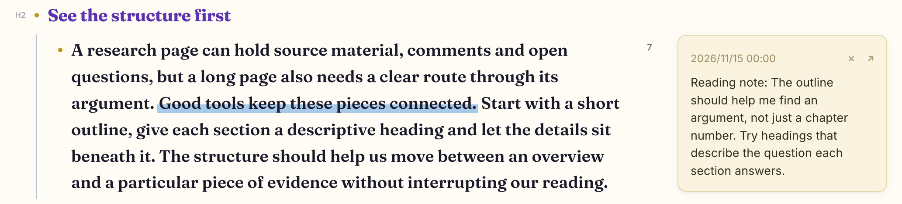
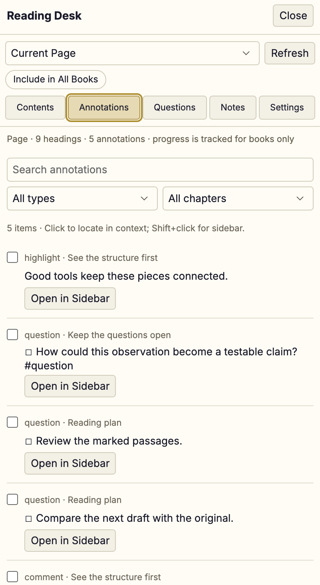
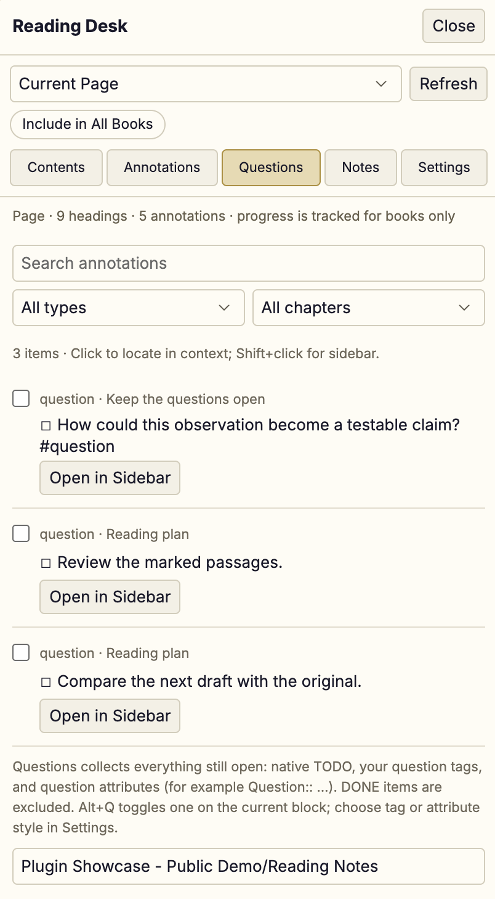
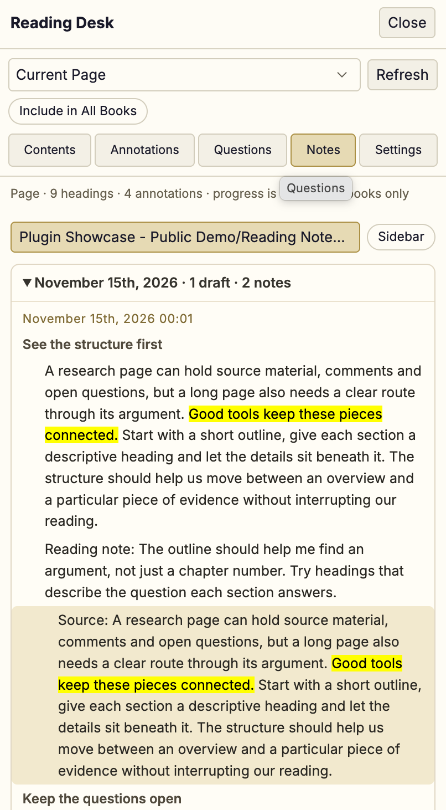
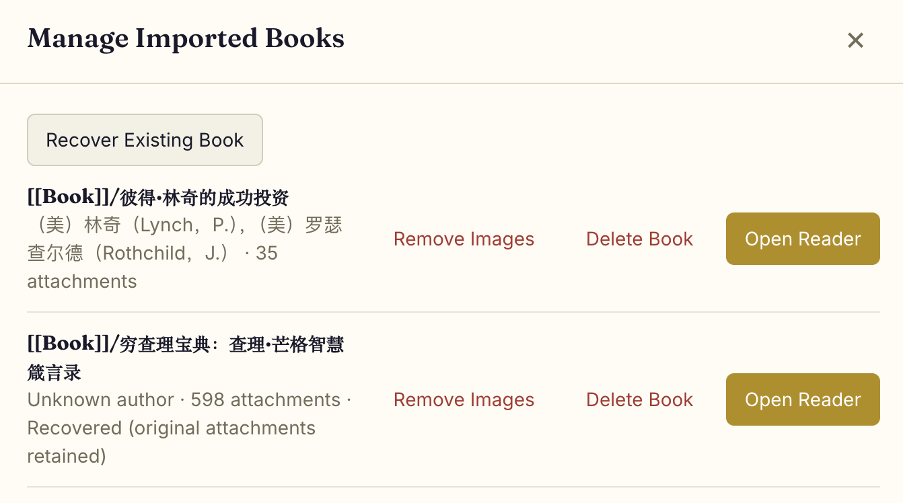

# Reading Desk

**See the structure of a page, and turn discoveries from your reading into connected notes.**

Reading Desk began with my own need to take reading notes in Roam Research. I wanted reading, annotation, questions and note-making to connect: find a passage worth keeping, add my own understanding, record a question I cannot yet answer, then bring these threads together into notes I can continue developing.

As the tool grew, I realised these needs also apply to ordinary pages. Project materials need a clear structure, research notes need evidence and comments, long articles need easy navigation, and meeting records need a way to organise unresolved questions. Many Reading Desk features therefore work directly with existing pages, without importing a book first.

## A table of contents opens up a long page

A long Roam page can hold a wealth of material, but it can also be easy to lose track of where you are. Reading Desk builds a hierarchical table of contents from the page's H1–H3 headings, placing its structure in a panel you can consult at any time.

Expand or collapse subsections, see your current chapter, and click an entry to scroll to its heading. Jumping changes only your reading position, preserving the text's existing collapsed state.

That makes the table of contents useful for books, project stages, research topics, course notes and meeting agendas alike. See the whole before entering the details, and quickly find a particular passage when you return.

## Keep annotations beside the source

As you read, use Roam's native highlighting to mark text that interests you, mark an entire paragraph, or record a question to think about further.

Native comments can appear beside their paragraphs, keeping the source and your own thoughts in the same field of view. Each paragraph supports multiple comments, and you can adjust the margin-note style, colour and chronological order. When you reread a passage, your earlier understanding, objections and supporting threads remain easy to find.

## Bring scattered highlights and questions together

Reading Desk gathers highlights, comments, paragraph marks and questions, with filters for type, chapter or keyword. The questions view can also include corresponding question tags, properties and unfinished TODOs, making it easier to work through the open questions left by your reading.

Gather material from the current page, imported books or ordinary pages you explicitly add to the collection scope. For example, if a project's source material is spread across several pages, include those pages to review important annotations and unresolved matters together.

## Turn annotations into your own notes

After a reading session, select the material you want to keep and generate a separate note draft. Generated notes connect to the original text through block references and retain links to the source pages, so the organised material remains traceable.

A typical workflow is:

1. **Read and annotate.** Highlight important material and write your understanding beside it. Record questions you cannot yet answer.
2. **Review together.** Filter by chapter or type and revisit the threads worth keeping. Consider recurring questions together and decide what needs further verification.
3. **Create notes.** Select highlights, comments and questions to generate a new note page. Keep the original references while developing your own understanding and connections.

You can also begin by collecting only questions, generate a question note, and then read, research and answer them one by one.

## If you start with a book

Reading Desk also supports EPUB import: convert the book's text into Roam blocks, organise it by chapter, and handle images, footnotes and internal links. Check the content in the import preview before completing the import and image upload.

Once the book is in Roam, use the same table-of-contents, annotation and note-making workflow. After reading, book management also lets you remove uploaded images while keeping the text, maintaining the material in the way that suits you.

Open a page and click the **Reading Desk** icon in the top bar to begin with the content already there.

Interface translations and documentation are available in English, Chinese, Italian, German, French and Spanish. See [Reading Desk's GitHub page](https://github.com/DelmarHuang/roam-reading-desk) for detailed features and instructions, including the [full manual](https://github.com/DelmarHuang/roam-reading-desk/blob/depot-submission-2026-11-15/docs/GUIDE.md).

